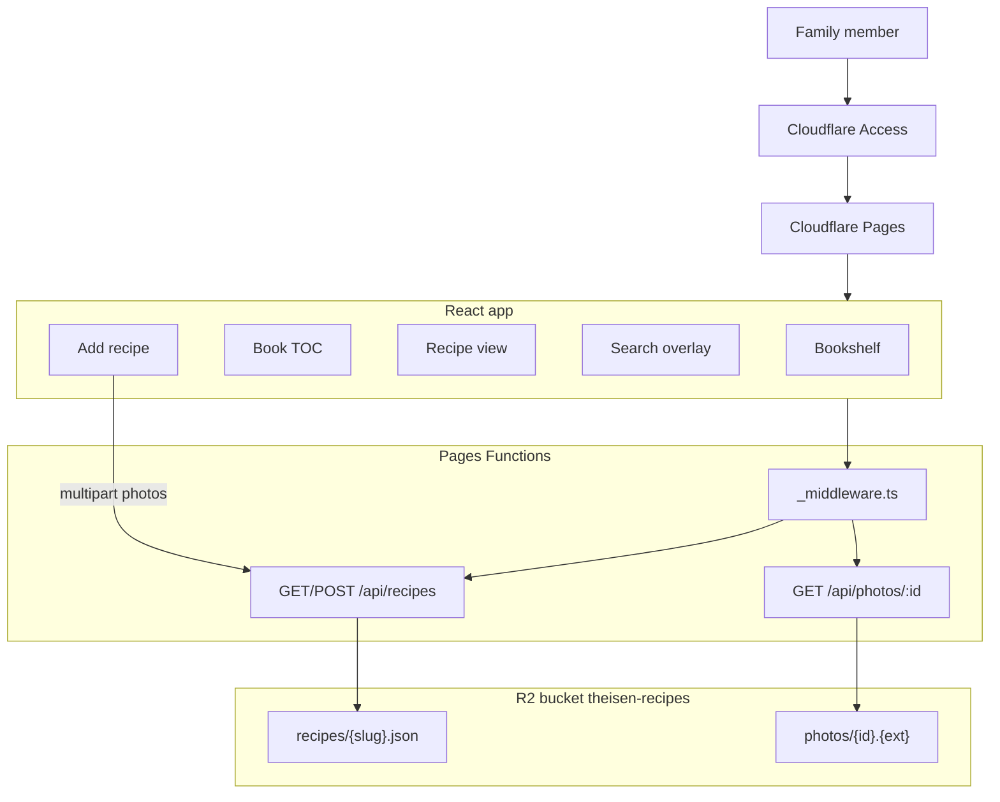

# Theisen Recipes

A private family cookbook. Books sit on a shelf by category. Search from the bar at the bottom; add a recipe with a title plus a photo or the recipe text.


## Architecture

Recipes and photos live in R2, not in git. The browser is a React SPA. Pages Functions sit in front of the bucket. Cloudflare Access (email one-time PIN) is the login gate.



| Route | Screen |
| --- | --- |
| `/` | Bookshelf |
| `/book/:bookId` | Table of contents for one book |
| `/recipe/:slug` | Recipe + photos |
| `/add` | New recipe form |
| Search bar | A–Z overlay; typing filters by title prefix |

Books: `baking`, `appetizers`, `mains`, `soups`, `miscellaneous`, `holidays`. Retired slugs: `desserts` → `baking`, `sides` → `miscellaneous`.

## Local development

```bash
pnpm install
cp .env.example .dev.vars
pnpm dev      # UI only (no R2, Add recipe cannot save)
pnpm pages    # full app at the URL wrangler prints (usually :8788)
pnpm test
pnpm check    # tests + typecheck + production build
```

`pnpm pages` uses a local R2 stand-in under `.wrangler/`.

## Adding a recipe

Title is required, plus a photo **or** ingredients/steps. Everything else is optional. Photos: JPEG, PNG, WebP, or GIF; up to 6, 8 MB each.
