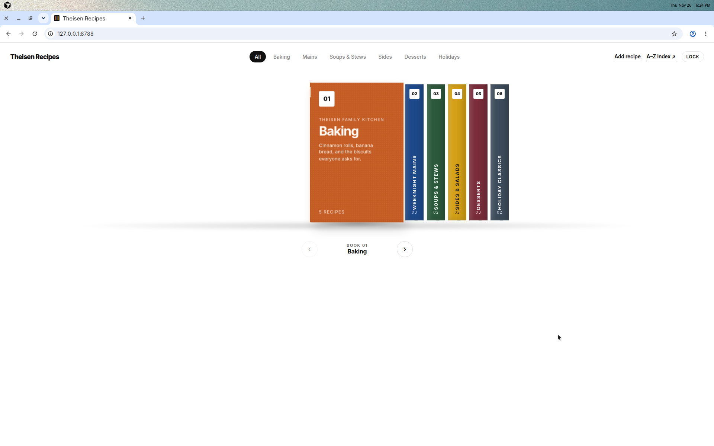

# Theisen Recipes

A family recipe bookshelf behind **Cloudflare Access** (email one-time PINs). Books sit on a 3D shelf by category; the search bar at the bottom opens an A–Z list that filters as you type; family members can add recipes and photos.

Recipes and photos live in the **R2** bucket (`theisen-recipes`), not in git. Add more from the **Add recipe** screen.



## Local development

```bash
pnpm install
cp .env.example .dev.vars
```

`.dev.vars` does not need Access secrets for local work. Origin JWT checks stay off until you set `CF_ACCESS_TEAM_DOMAIN` and `CF_ACCESS_AUD`.

### UI only (Vite)

```bash
pnpm dev
```

Fast HMR for layout work. There is **no Cloudflare Access gate** and **no R2**, so Add recipe cannot save.

### Full app (Cloudflare Pages + Functions + local R2)

```bash
pnpm pages
```

This builds the site and runs `wrangler pages dev`. Open the URL Wrangler prints (usually `http://127.0.0.1:8788`).

- Auth: none locally unless both Access vars are set in `.dev.vars` (then every request needs a valid `Cf-Access-Jwt-Assertion` header or `CF_Authorization` cookie)
- Family recipes and photos: local R2 simulation of the `RECIPES` binding (persisted under `.wrangler/`)

```bash
pnpm test
pnpm check    # tests + typecheck + production build
```

## Adding recipes

### Real family recipes (recommended)

1. Open the bookshelf (in production, Cloudflare Access emails a one-time PIN).
2. Click **Add recipe**.
3. Give it a **title**, plus a **photo or the recipe text** (ingredients or steps). Book, contributor, times, and notes are optional.
4. Attach pictures if you have them (JPEG, PNG, WebP, or GIF; up to 6, 8 MB each).
5. Save. The recipe JSON and photos go to the **R2 bucket**; they survive deploys.

`category` must be one of: `baking`, `mains`, `soups`, `sides`, `desserts`, `holidays`.

## Deploy to Cloudflare Pages

1. Create an R2 bucket named `theisen-recipes` in the same account:

   ```bash
   pnpm wrangler r2 bucket create theisen-recipes
   ```

2. Create a Pages project from this repo (build command `pnpm run build`, output `dist`, root `/`). Wrangler config already sets `pages_build_output_dir` and the `RECIPES` R2 binding.

3. Put Cloudflare Access in front of the custom domain (`recipes.palko.dev`) as a **self-hosted application** with **email one-time PIN** (or another Access policy). Visitors sign in once at Cloudflare Access; there is no in-app password screen. **Sign out** in the header sends them to `/cdn-cgi/access/logout`.

4. Optional, for defense-in-depth JWT checks at the origin (Pages Functions). In **Settings → Environment variables**:

   - `CF_ACCESS_TEAM_DOMAIN` — Cloudflare One team domain, e.g. `your-team.cloudflareaccess.com`
   - `CF_ACCESS_AUD` — Application Audience (AUD) tag from **Zero Trust → Access → Applications**

   When both are set, `_middleware.ts` verifies `Cf-Access-Jwt-Assertion` (or the `CF_Authorization` cookie) against the team JWKS (`https://<team>.cloudflareaccess.com/cdn-cgi/access/certs`): RS256 signature, `aud`, `iss`, and `exp`. Missing or invalid tokens return **401**. When either var is unset (local `wrangler pages dev`, or before these are added in the dashboard), requests pass through and SPA document fallback still works.

   You can remove the old `BOOKSHELF_PASSWORD` and `SESSION_SECRET` secrets if they are still on the project.

5. Confirm **Settings → Bindings** includes R2 `RECIPES` → `theisen-recipes`. Redeploy after adding the binding if you set it in the dashboard instead of `wrangler.jsonc`.

Access, not this repo, holds the family email list. Recipe JSON, photos, and the JS bundle stay behind Access at the edge.

## Architecture

| Piece | Where |
| --- | --- |
| Family recipes | R2 `recipes/{slug}.json` |
| Photos | R2 `photos/{id}.{ext}`, served at `/api/photos/:id` |
| Auth | Cloudflare Access (email OTP) + optional origin JWT verification |
| UI | Vite + React, Cloudflare Pages static output |
